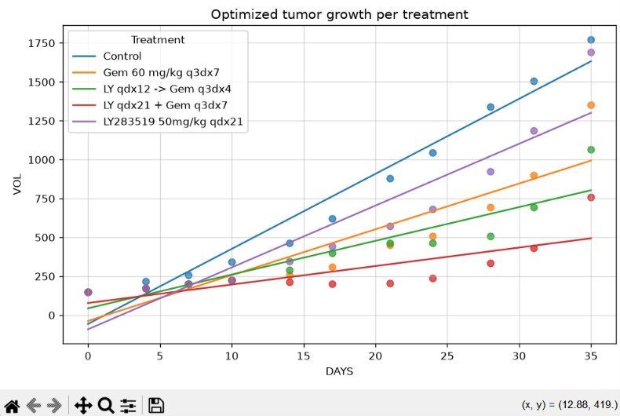

# Logboek Emiel: Casus 1

### Maandag 16 november

Tijdens de introductieles hebben we de introductie gekregen over de module van deze periode.
Dit project bestaat uit 4 casussen die uitgewerkt gaan worden in tweetallen.

Ik ben het eerste casus ingedeeld met Joris. Deze eerste les hebben we de volgende taken verricht:

- Repository aanmaken.
- Taakverdeling gemaakt op basis van de eerste twéé workshops:
    - Emiel workshop 1
    - Joris workshop 2
- Basic visualisatie gemaakt voor workshop 1 op basis van gegenereerde data.

Voor het SIR-model heb ik een aparte dataset laten genereren, omdat de dataset die we eerder 
in de les hebben aangemaakt niet voldeed aan de eisen voor een SIR-model. 

We hebben de implementie gedaan in een python-classe. Binnen die classe heb ik functies aangemaakt. 
De eerste functie is bijna 1:1 overgenomen uit de opdracht, met enkele aanpassingen in de stapgrootte. 

Vervolgens heb ik een plot-functie gemaakt die, net zoals in het voorbeeld, een trend laat zien door de 
tijd heen in een hypotetische populatie. 

Met de labels "b-", "r-" en "g-" laat ik ook
 de individuele datapunten zien uit de dataset.

[AI Prompt voor de dummy data SIR-model]
"Genereer een dummy dataset op basis van de parameters bij 
het SIR-model met outliers. Maak de dataset niet te groot, 
het is voor modelleren."

[AI Prompt voor de dummy data Tumorgroei]
"Genereer een dummy dataset op basis van een realistische 
tumorgroei met outliers. De dataset is voor modelleren."

 ### Woensdag 18 november

 Gisteren heb ik inhoudelijk niet echt meer iets veranderd aan de code voor workshop 1. 
 Ik heb thuis wel wat gespeeld met verschillende waarden voor de SIR-parameters. Hieruit 
 kwam dat bijvoorbeeld Beta (transmissiesnelheid) verhogen tot een hogere piek leidde. 
 Door bijvoorbeeld het verlagen van de gamma (herstelsnelheid) kreeg je ook hogere pieken omdat mensen vaak gelijktijdig besmet zijn. 

 In de les hebben we uitleg gekregen over de workshop 3 "Optimalisatie".
 Aan de hand van de taakverdeling met Joris ga ik dit gedeelte uitwerken. 
 Ik ga de workshopbeschrijving erbij pakken en kijken of ik representatieve data kan vinden 
 voor de bewerking daarvan. 

 De code uit het voorbeeld ga ik aanpassen en eigen maken. Ik denk niet dat ik alles 100% 
 overneem uit de code en methodieken. Ik ga me focussen op verdiepingselementen zoals Monte Carlo / random search. 
 

Voor de analyse met echte data gebruiken we data van het NCBI.
[A simple model of a growing tumour](https://pmc.ncbi.nlm.nih.gov/articles/PMC6546075/#_ad93_).

Ik heb voor nu de dataset geüploadet in "generated_data", om te voorkomen dat ik een extra directory moet maken.
Let op: het is **geen** gegenereerde data, maar echte. 

Voor het inlezen van de data heb ik een eenvoudige inleesfunctie gemaakt die Joris nu ook kan gebruiken. Hier valt 
verder niet veel over te melden aangezien dit een eenvoudige functie is.

De data betreft een onderzoek naar tumorgroei in een experimentele setting. Het experiment is uitgevoerd op 10 muizen, met 
2 muizen in de controlegroep en 8 muizen die een behandeling ondergaan zijn. 

| Groep | Behandeling | Aantal muizen |
|---|---|---:|
| Controle | Geen medicijn | 2 |
| Gemcitabine | 60 mg/kg | 2 |
| LY2835219 | 50 mg/kg | 2 |
| LY, vervolgens Gemcitabine | Opeenvolgende behandeling | 2 |
| LY + Gemcitabine | Combinatiebehandeling (beide tegelijk) | 2 |
| **Totaal** | | **10** |

### Donderdag 19 november

Ik heb gisteravond een functie toegevoegd aan de main. Deze functie 
plot de tumorgroei per reference (dus op Controle en behandeling). 

De grafiekjes worden nu nog afzonderlijk geplot. Dit is het begin om te kijken 
of de data juist wordt ingelezen en geplot. Mijn doel vandaag/morgen
 is om de code zo in te stellen dat alle 5 condities geplot worden 
 in één figuur. 

Wat ik voor de rest vandaag wil doen is het doorspitten van de 
rubrics voor dit vak. Op die manier wil ik bekijken wat er precies allemaal 
nodig is voor een gedegen product. 

Ik heb even gekeken naar de rubric en dit zijn de belangrijkste punten die 
ik eruit heb gehaald:

1) Notebook is: reproduceerbaar, navolgbaar.
2) De code: werkt, is efficiënt en maakt gebruik van externe modules en/of implementaties. 
3) Reproduceerbaarheid via Git. 
4) Toelichtingen in het notebook/ logboek.
5) Biologische betekenis m.b.t. modelleren van kanker. 
6) Code verdedigen in mondeling. 
7) Analysestappen worden verdedigd in het logboek. 

Zie voor de precieze beoordeling het rubric bestand.

Dit typ ik voor de les, dus eventuele nieuwe inzichten zullen hieronder verder 
worden uitgewerkt. 

Ik heb tijdens de les verder gewerkt aan de optimalisatie workshop. 
Het script `def plot_optimalization()` berekent nu aan de hand van de in 
de workshop geleverde HTML random search een lineaire optimalisatielijn. 

Het script is nu nog een beetje rommelig. Dit komt met name om het feit 
dat we in de meeste scripts dezelfde optimalisatie-stappen nemen. Ik zal me 
na vandaag focussen op het integreren van een meer reproduceerbare manier hiervoor. 

Joris stelde voor om bijvoorbeeld een standaardfunctie hiervoor te maken, waarna 
je in de main alleen nog maar de juiste parameter-waarden mee hoeft te geven. 

Daarnaast heb ik op dit moment alleen nog een lineaire toepassing gemaakt voor de Workshop 3. 
Dit wil ik dit weekend uitbreiden/aanpassen naar een exponentieel model. Dit past ook veel 
beter bij tumorgroei. Tumorgroei is namelijk niet een lineair proces, het neigt juist 
vaker naar een exponentieel verband. 

Hieronder is de foto te zien van de plot die 
nu gegenereerd wordt aan de hand van het lineaire model. 

De grafiek toont de gemeten tumorwaarden (scatterpoints) en de 
bijbehorende lineaire trendlijnen. Met behulp van random search zijn per behandelconditie 
de parameters bepaald die de MSE (mean squared error) minimaliseren. 
Op deze manier zijn de 5 condities gezamenlijk te vergelijken. 

De controlegroep verootn in deze dataset de sterkste lineaire groei, terwijl de 
behandeling LY+ Gemcitabine de laagste groei. We kunnen dus voorzichtig zeggen dat 
de muizen met die gecombineerde behandeling het minste tumorgroei laten zien. 

Zoals eerder benoemd is dit het lineaire model. Na het implementeren van de exponentiele variant ga ik weer een analyse doen.

De formule voor het exponentiele groei model is: V(t) = V(0)e^at 

 