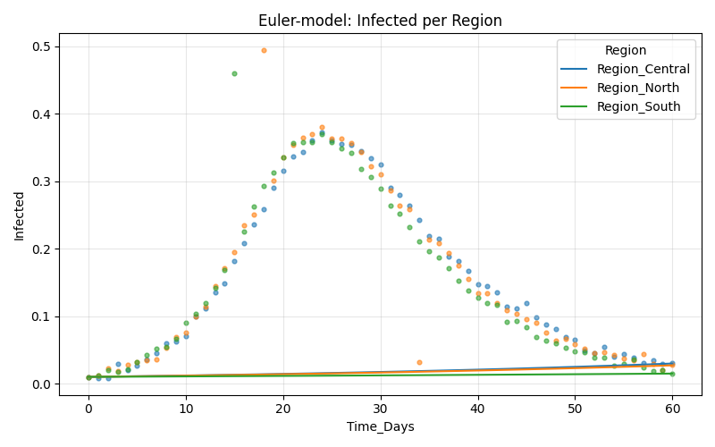

# Logboek Joris Deelstra

## 16-nov-2026

### Start-up

Vandaag is de start-up van deze module, en ook casus.

Het doel van deze casus is om een python module te maken, met erin classes heeft die tumorgroeimodellen kan maken en fitten.
Hierbij moet een uitgebreid markdown readme document met de volgende eisen:

1. Technische specificaties en afhankelijkheden
2. Bondige achtergrondinformatie over modellen en technieken
3. Referenties

Emiel heeft de github repo gemaakt, ik heb er de main.py en logboeken/ aan toegevoegd.

In de uitleg voor het project wordt er gerefereerd naar [DOI: 10.47611/jsrhs.v12i4.5202](https://doi.org/10.47611/jsrhs.v12i4.5202), echter is de DOI site op 16 nov niet bereikbaar. 
Ik heb artikel ook gevonden op de volgende site:
[ResearchGate.net](https://www.researchgate.net/publication/378286328_Treatment_Optimization_for_Tumor_Growth_by_Ordinary_Differential_Equations).

Het artikel gaat over hoe optimale behandelings tijdschemas kunnen worden gemaakt o.b.v. data van drie ODE modellen voor verschillende kanker soorten.
De conclussie is dat optimale tijdschemas per soort verschillend zijn, wat erop duid dat er geen universele is. Ook is er geen rekening gehouden met radiotherapie en bijwerkingen.
Wat voor ons interessant is is dat er veel modellen worden benoemd, en ook hoe modellen toegepast kunnen worden op kanker-groei; precies wat wij gaan doen. Ik neem aan dat we veel gaan refereren naar dit artikelen.

Nadat ik de casus documentatie heb doorgelezen heb ik samen met Emiel gezeten voor een taakverdeling.
Wat daaruit kwam, is dat we het afwisselend per workshop de bijbehorende modellen zullen toevoegen aan één python class.

Ik heb nu de basis class gemaakt. Gezien dat binnen twee minuutjes klaar is heb ik een plot-functie gemaakt die de data waarmee de class wordt ingeladen plot.
Emiel heeft dummy data gegenereerd.

### Data-Analyse

De data structuur is als volgt:
- Subject_ID (str) Group (str) Time_Days (int) Tumor_Volume_mm3 (float) Body_Weight_g (Float)

* Er zijn 30 Subjects
* Er zijn 3 groepen (control, treatment low, treatment high) met elk 10 subjects
* De tijdspan is 28 dagen, elke 3 dagen wordt er een sample genomen

Wat uit de data-analyse komt, waarin ik tumor volume tegen tijd (28 dagen) heb geplot, is als volgt:
1. Control neemt van ~100 naar ~1000-1400 toe, met 1 uitzondering waar op dag 15 een sample op 1400 zit, en een Subject waarbij de tumor langzaam afneemt van grootte.
2. Treatment Low neemt van ~100 naar ~500-700 toe, met 1 uitzondering op dag 17 waar een sample ~0 is, en een subject waarbij de tumor stopt met groeien op ~300.
3. Treatment High neemt ~niet toe, met een uitzondering op dag 10 waar een sample ~900 volume wordt, en van een subject die van ~100 naar ~1800 volume gaat.

Alhoewel het niet zo handig is voor sommige modellen dat er outliers zijn, gezien we de modellen moeten fitten, lijkt het ons wel interessant om de data zo te houden om te kijken hoeveel invloed het heeft op de modellen.
Na overleg met Emiel willen we misschien wel een tweede dataset aanmaken maar dan zonder de outliers.

### Workshop 2

Na de workshop ben ik bezig gegaan met het Euler model te implementeren in de class.
Voor onze tumor data set werkt dit prima. De lijn komt relatief overeen met de data.
Ik heb het nog niet geprobeerd zonder de outliers eruit te filteren / n nieuwe dataset te genereren zonder outliers.

Bij de corona data-set gaf numpy divide by zero errors, en was de reference 'Recovered' niet geplot.
Dit komt omdat de regions als startpunt allemaal 0 hebben; hierdoor wordt r oneindig.
Deze error heb ik 'opgelost' door een if statement toe te voegen waarbij als het 0 is het wordt vervangen door 0.1.

Het Euler model werkt overigens ook niet bij deze dataset. Dit komt omdat Euler linear toe of af neemt, en niet trendlines kan maken die een andere vorm dan linear hebben. Dit is vooral te zien bij Infected per Region. 